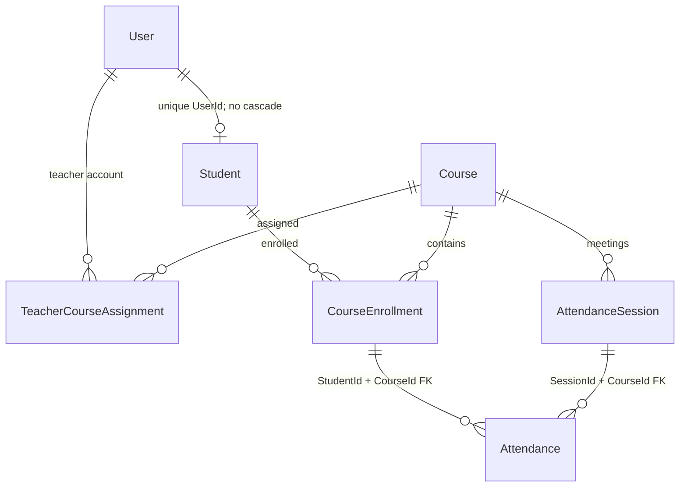

# Milestone 3: attendance design and migration plan

Prepared 2026-10-24 (Asia/Katmandu). Implementation and disposable tests are complete; the project database has **not** been inspected, connected to, or migrated. Applying the migration to a persistent/shared database requires the user's explicit approval. No existing migration was edited or deleted. No frontend or production dependency changes were made.

## Compatibility assessment before implementation

The two existing SQL Server migrations create Users, Students, Courses and Attendances, then add Method. The baseline has required identity/FK columns but uses cascade deletes, permits multiple Student profiles for the same User, and has no enrollment, teacher assignment or class-session model. Attendance.Date is a caller-supplied `datetime2`; it cannot establish meeting identity or even prove the original timezone. Status/Method are unbounded arbitrary strings, including empty historical Method values. Milestone 2 improved DTO/security boundaries but could not enforce session uniqueness.

The implementation preserves existing identity values, entity rows, course/student relationships, and dates. It intentionally changes the attendance POST contract and teacher resource scope to use the new relationships. Deploy schema and backend together during a maintenance window; an old backend must not keep writing rows without session links after the migration. DTO projections and password-hash protection remain in place.

The migration aborts before schema changes if multiple Student rows share a UserId. It does not delete, merge, relink or renumber those profiles. Such conflicts require a separately reviewed reconciliation. No live data was queried to claim that preflight will pass.

## Model and database invariants



| Entity / rule | Implementation |
| --- | --- |
| Student account | Unique Students.UserId; one User can have zero or one Student profile. Existing API verifies Student role. |
| Enrollment | CourseEnrollments composite PK `(StudentId, CourseId)` and required Student/Course FKs. `IsLegacyInferred` distinguishes historical evidence from confirmed enrollment. |
| Teacher assignment | TeacherCourseAssignments composite PK `(TeacherUserId, CourseId)` and required User/Course FKs. Admin-only API verifies the linked account has Teacher role. No assignments are inferred from old attendance. |
| Class meeting | AttendanceSessions identity PK; CourseId FK; UTC start/end for verified meetings. Check constraint requires nonnull ordered times for verified sessions, or explicitly flagged legacy provenance with unknown times. |
| Session/course identity | Alternate key `(AttendanceSessionId, CourseId)` lets Attendance use a composite FK to prohibit course/session mismatch. |
| Student/course eligibility | Attendance `(StudentId, CourseId)` references an actual CourseEnrollment; an arbitrary existing Student and Course are insufficient. |
| No duplicate marks | Unique index `(StudentId, AttendanceSessionId)`. Concurrent inserts cannot create two marks; API returns 409 for duplicate/conflicting marking rather than silently overwriting history. |
| Multiple meetings/day | Course/start-time index is deliberately nonunique. Each meeting gets its own session ID; no calendar-day uniqueness or grouping exists. |
| Values | Required bounded Status/Method columns and check constraints; explicit API allowlists for new marks. |
| History protection | All relevant FKs use NO ACTION. Deleting referenced users/students/courses/enrollments/sessions cannot cascade away attendance history. |

Role semantics (Student versus Teacher), confirmed-versus-inferred enrollment eligibility, and rejecting new marks on legacy placeholders are enforced by API/service rules. FKs enforce existence/membership, not account-role strings or cross-row confirmation flags. Direct SQL access remains privileged; recognition/frontend must use the API. There are no role-change or unenrollment endpoints in this milestone; future changes must preserve these semantics and historical relationships.

Enrollment is currently a Student/Course pair, not a full multi-term registrar model. If the college reuses course IDs across academic offerings, define offerings/terms and enrollment periods in a later reviewed migration before supporting re-enrollment in a different term. Global email/course-code/roll-number uniqueness has not been added without agreeing normalization and institutional scope; duplicate emails remain a separate security roadmap issue.

## Defined statuses and methods

| Status | Meaning |
| --- | --- |
| Present | Staff confirms attendance at the meeting. |
| Absent | Staff explicitly records absence; a missing row remains unmarked, not automatically Absent. |
| Late | Staff confirms attendance with lateness. Cutoff/percentage rules need college agreement. |
| Excused | Staff records an approved excused absence. Reporting denominator policy is not inferred. |
| Unverified | Historical status could not be classified. Migration/reconciliation vocabulary only; new manual requests cannot submit it. |

| Method | Meaning |
| --- | --- |
| Manual | Entered through the manual marking endpoint; server-controlled. |
| FaceRecognition | Recognized historical provenance vocabulary and a future integration value. No recognition engine/model/API is introduced or permitted by this string. |
| LegacyUnknown | Historical method was blank or unrecognized. New marking cannot claim this method. |

All pre-existing status/method text is copied exactly into LegacyStatus/LegacyMethod before canonicalization or narrowing. Known trimmed/case variants are mapped to canonical labels; unknown statuses map to Unverified and unknown methods to LegacyUnknown. Legacy rows remain flagged even if their old text says Present or FaceRecognition; those claims were not newly verified. Raw legacy text is not exposed in response DTOs.

## Preservation algorithm

Migration: `20261024061936_SessionAttendanceIntegrity` (SQL Server only).

1. Check duplicate Students.UserId and fail explicitly if found, before any schema operation.
2. Replace cascade FKs/indexes as required and add new columns/tables. AttendanceSessionId is initially nullable, avoiding fake session ID 0.
3. Insert one inferred CourseEnrollment for each distinct historical StudentId/CourseId pair.
4. Insert **one legacy placeholder session per original attendance row**, linked to the same course. Its ID/provenance records the original AttendanceId; its start/end remain NULL. Identity allocation is preserved for subsequent real meetings.
5. Populate each attendance's required session link; copy original Status/Method to unrestricted legacy columns; canonicalize the active labels. AttendanceId, StudentId, CourseId and Date are unchanged.
6. Make session links nonnullable; bound canonical fields; create unique/check constraints and composite/restrictive FKs.
7. Record the migration in EF history only on successful completion.

No grouping is based on date, and even exact duplicate old timestamps are retained as separate original rows. A placeholder does not represent proof of a real class meeting. Duplicate historical marks cannot safely be merged automatically. Before reporting attendance percentages, reconcile legacy rows against approved timetables/evidence. Confirm inferred enrollments explicitly and create verified meetings. If several originals belong to one student/meeting, preserving their history while reconciling requires a reviewed archive/correction design; do not delete rows to bypass the unique key. This milestone does not perform that reconciliation or count placeholders as verified classes.

The Up path does not drop entity tables or delete records. SQL Server migration transactions protect the staged changes; preflight and rollback-on-failure behavior were tested. Session/relationship removal would lose new information, so Down deliberately throws instead of emitting destructive rollback operations. Use an approved backup restoration or reviewed forward correction for recovery; never downgrade the new backend/schema independently.

## API changes and operating sequence

All new requests reject unknown fields and nested EF entities. Existing Admin-only user/student management, safe DTOs and Student attendance ownership remain intact. Teacher attendance reads/writes are now limited to assigned courses; an unassigned Teacher sees an empty attendance list/404 details and cannot mark/schedule those courses. No blanket Teacher permissions are inferred for existing courses.

1. Admin creates/uses the Course and Student accounts/profiles as before.
2. `POST /api/courses/{courseId}/enrollments`, body `{ "studentId": 1 }`: Admin confirms enrollment (including an inferred historical pair), returns safe enrollment DTO with 200. A confirmed duplicate returns 409.
3. `POST /api/courses/{courseId}/teacher-assignments`, body `{ "teacherUserId": 22 }`: Admin assigns an existing Teacher account, returns safe assignment DTO with 200; duplicate returns 409. Teachers may still create course catalog entries as before, but an Admin must assign them before scheduling/marking that course.
4. `POST /api/attendancesessions`: Admin or assigned Teacher supplies `{ "courseId": 1, "startsAt": "2026-10-24T09:00:00+05:45", "endsAt": "2026-10-24T10:00:00+05:45" }`. Times are stored in UTC; 201 returns a safe session DTO and Location. `GET /api/attendancesessions/{id}` is available to Admin/assigned Teacher. A second same-day meeting gets a distinct session ID.
5. **Changed contract:** `POST /api/attendances` takes `{ "studentId": 1, "attendanceSessionId": 42, "status": "Present" }`. CourseId comes from the verified session; Date is the server's UTC recording time and Method is Manual. Supplying courseId/date/method/legacy fields is rejected. New marking requires confirmed enrollment, a real session and Admin/assigned Teacher access. Duplicate returns 409.
6. Attendance DTOs retain their safe fields and add `attendanceSessionId` and `isLegacy`. The historical Date remains unchanged and may have unknown timezone/meaning; `isLegacy` distinguishes it from the new recording-time semantics. Actual class time comes from the session, not Attendance.Date.

No percentages, automatic absence generation, session finalization, late cutoffs or backdating policy were invented. Those need college rules. Frontend contracts must be updated by Samrat; frontend files were not changed. Face recognition remains gated by explicit college permission, and the current marking endpoint accepts Manual provenance only.

## Deployment and migration steps requiring review

Do not execute a database update as part of repository review.

1. Identify the intended environment, SQL Server version and exact applied migration history. Review [PREFLIGHT_READ_ONLY.sql](migrations/PREFLIGHT_READ_ONLY.sql) against that environment when authorized. Stop for missing/unexpected schema history, duplicate student profiles, or orphans. Review non-Student profile links and duplicate identities separately; preserve all source data.
2. Take and verify a restorable backup. Record baseline row counts and restricted-access exports/checksums of the original attendance columns. Confirm a maintenance window and stop old writers.
3. Rehearse this migration on a disposable restoration of the actual data, because synthetic tests cannot prove compatibility with unseen live records. Review transaction/log capacity, locks, backup/restore time and the legacy reconciliation workload.
4. Review the C# migration and [generated idempotent upgrade SQL](migrations/20261024061936_SessionAttendanceIntegrity.sql). This upgrade script expects the database already at AddAttendanceMethod. Verify that prerequisite explicitly; idempotent history guards do not repair an unknown/missing baseline. The design-time factory deliberately targets an offline dummy endpoint and never reads local credentials.
5. Obtain explicit approval before a DBA/user applies the reviewed SQL through an approved deployment connection. This session did **not** apply it. Keep writers paused until the new backend is deployed.
6. Validate row counts and original AttendanceId/StudentId/CourseId/Date plus LegacyStatus/LegacyMethod against the backup/export. Expect one placeholder per old row, inferred enrollment per historical pair, zero inferred Teacher assignments, nonnull session links and successful FK/unique constraints.
7. Deploy the new backend and coordinate frontend contract changes. Confirm actual enrollments/assignments, create real meetings and smoke-test own-student privacy and duplicate 409 handling using synthetic test accounts. Separate legacy reconciliation from normal marking. Retain the backup and original audit evidence.

Generate/review scripts without connecting to SQL Server:

```bash
dotnet build SmartAttendanceSystem.sln --no-restore
dotnet ef migrations has-pending-model-changes --project SmartAttendance.API --no-build
dotnet ef migrations script 20260825122101_AddAttendanceMethod \
  20261024061936_SessionAttendanceIntegrity --project SmartAttendance.API --no-build \
  --idempotent --output /tmp/smartattendance-upgrade.sql
# For a fresh empty installation, generate the complete migration chain instead:
dotnet ef migrations script 0 20261024061936_SessionAttendanceIntegrity \
  --project SmartAttendance.API --no-build --idempotent --output /tmp/smartattendance-fresh.sql
```

The design-time factory is intentionally not a deployment connection resolver. Do not change it to pick up local credentials merely to run a migration. Review/apply generated SQL separately after approval. Existing migrations and production dependency versions are unchanged.

## Automated verification

Run from repository root with restored dependencies:

```bash
dotnet build SmartAttendanceSystem.sln --no-restore
# HTTP/security and relational SQLite tests; nine SQL Server tests explicitly skipped:
dotnet test tests/SmartAttendance.IntegrationTests/SmartAttendance.IntegrationTests.csproj --no-build --no-restore
# Full suite, using only a newly created private disposable SQL Server container:
SMARTATTENDANCE_RUN_SQLSERVER_TESTS=1 dotnet test \
  tests/SmartAttendance.IntegrationTests/SmartAttendance.IntegrationTests.csproj --no-build --no-restore
```

The SQL fixture requires Docker and the locally cached `mcr.microsoft.com/mssql/server:2022-latest` image (`--pull=never`); it launches a uniquely named/labeled Developer instance with a random secret, a loopback-only random port and a 2 GiB limit. It accepts no external connection string, creates random test databases only inside that instance, and removes only its own container/volumes. No persistent database or unrelated container is reset, queried, stopped or removed. Without opt-in, SQL tests are visibly skipped rather than reported as passed.

Final verification: **177 passed, 0 failed, 0 skipped**, including nine real SQL Server tests. Build passed with zero errors and the four existing NU1902/NU1903 PKCS warnings inherited by API/tests. Model-drift check passed. Generated idempotent SQL and upgrade paths were tested. `git diff --check` passed. The disposable container was removed.

SQL tests cover uniqueness, two same-day meetings, mismatched course/session, missing enrollment, invalid FKs/status/method/times, duplicate student/account links, enrollment/assignment duplicates, deletion protection, concurrent writers, legacy duplicates/long raw values/unknown methods, duplicate-profile abort, fresh migration installation, and idempotent SQL reruns. HTTP tests retain Milestone 2 security coverage and add assignment scope, enrollment confirmation, legacy rejection, session validation/provenance protection, and same-day/duplicate marking behavior.

Not run: migration on the actual project database or a restoration of actual data; frontend/recognition integration; load/capacity/recovery tests. Actual-data rehearsal and deployment remain pending approval. Existing PKCS dependency advisories and the broader security/attendance roadmap remain open. No AI integration, commit or push was performed.
